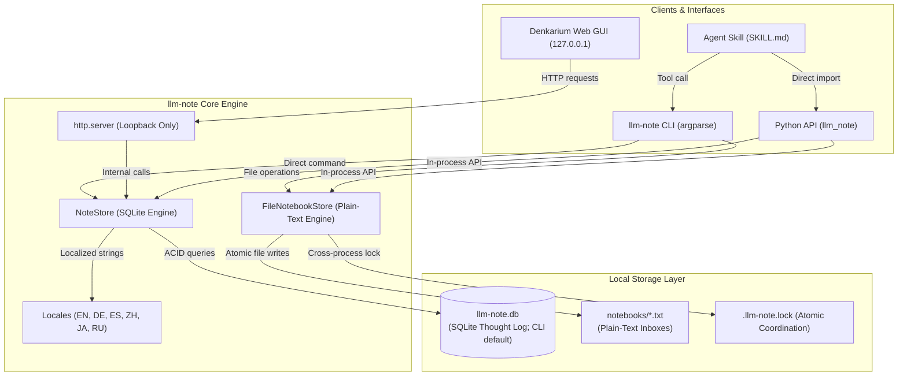
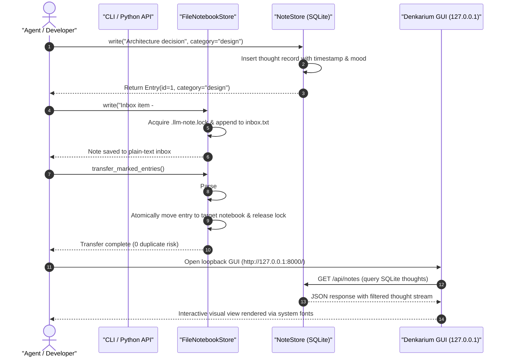

# llm-note

[](https://github.com/doc-bricks/llm-note/actions/workflows/ci.yml)
[](CHANGELOG.md)
[](LICENSE)
[](pyproject.toml)
[](pyproject.toml)
[](CHANGELOG.md)
[](CONTRIBUTING.md)
[-brightgreen.svg)](THIRD_PARTY_LICENSES.md)
[](https://github.com/astral-sh/ruff)
[](https://github.com/doc-bricks)
[](https://github.com/open-bricks)
[](llms.txt)

[English](README.md) · [Deutsch](README_de.md) · [Español](README_es.md) · [简体中文](README_zh-Hans.md) · [日本語](README_ja.md) · [Русский](README_ru.md)

> [!NOTE]
> **Local-first note storage:** `llm-note` stores notes in local SQLite and plain-text files. Core note storage does not require a hosted notes service or API key. The optional web interface binds to loopback; host settings govern network access.

---

## Quick Navigation

1. [Overview & Why This Exists](#1-overview--why-this-exists)
2. [Key Capabilities & Architecture](#2-key-capabilities--architecture)
3. [Visual System Architecture](#3-visual-system-architecture)
4. [Note & Transfer Lifecycle Sequence](#4-note--transfer-lifecycle-sequence)
5. [Target Personas & Discoverability](#5-target-personas--discoverability)
6. [Comparative Matrix vs. Alternatives](#6-comparative-matrix-vs-alternatives)
7. [Governance & Implementation Notes](#7-governance--runtime-invariants)
8. [Denkarium Local Web GUI Guide](#8-denkarium-local-web-gui-guide)
9. [CLI Complete Reference & Examples](#9-cli-complete-reference--examples)
10. [Python API Guide & Code Examples](#10-python-api-guide--code-examples)
11. [Agent Skill & Workflow Integration](#11-agent-skill--workflow-integration)
12. [File-Based Inboxes & Transfer Semantics](#12-file-based-inboxes--transfer-semantics)
13. [Sibling Ecosystem Matrix](#13-sibling-ecosystem-matrix)
14. [Third-Party Dependencies & License Scope](#14-third-party-licenses--transparency)
15. [Security Policy & Response Targets](#15-security-policy--slas)
16. [Verification & Contract Test Suite](#16-verification--contract-test-suite)
17. [Legal Note: § 521 BGB](#17-german-statutory-notice--521-bgb)
18. [Roadmap & Changelog](#18-roadmap--changelog)

---

<a id="1-overview--why-this-exists"></a>
<a id="overview--why-this-exists"></a>
<a id="1-ueberblick--warum-dieses-projekt-existiert"></a>
<a id="ueberblick--warum-dieses-projekt-existiert"></a>
## 1. Overview & Why This Exists

**llm-note** is an ultra-lightweight, zero-service local notebook engine — primarily a notebook for humans that AI assistants and coding agents write into for their user, and, depending on how it's used, a notebook shared by both.

AI assistants and LLM agents frequently need a place to record decisions, capture context observations, and brainstorm ideas so their user can read them later — and, in shared use, so human and agent can both refer back to them. Traditional solutions require heavy vector databases, hosted SaaS subscriptions, or bloated Electron applications that consume system resources and leak telemetry.

### Modes

`llm-note` doesn't enforce a mode — it's the same plain notebook used in whichever of these ways fits the moment:

- **For humans, from LLMs** (default): the human reads; their AI assistant writes notes for them.
- **From humans, for LLMs**: the human leaves notes for their assistant to read.
- **Shared cowork space**: human and AI assistants write into the same notebook — your LLMs share your space.

`llm-note` provides the ideal architectural middle ground:
- **Zero External Runtime Dependencies**: Built entirely upon the Python standard library (`sqlite3`, `http.server`, `urllib`, `argparse`, `json`, `pathlib`).
- **Dual-Store Flexibility**: Combines structured SQLite thought entries (CLI default: `llm-note.db`; path configurable) with human-editable plain-text inboxes (`notebooks/*.txt`).
- **BACH Extraction Provenance**: Cleanly decoupled from the [BACH desktop assistant codebase](https://github.com/ellmos-ai/bach), specifically Notizblock and Denkarium, and open-sourced under the permissive MIT license.

---

<a id="2-key-capabilities--architecture"></a>
<a id="key-capabilities--architecture"></a>
<a id="2-kernfaehigkeiten--architektur"></a>
<a id="kernfaehigkeiten--architektur"></a>
## 2. Key Capabilities & Architecture

- **SQLite Thought Log (`NoteStore`)**: Store structured notes, logbook entries, categories, mood values, and task promotion markers with full ACID reliability.
- **Plain-Text Notebook Inboxes (`FileNotebookStore`)**: Manage portable plain-text notes with `#NB:` categorization markers and atomic cross-process file locking.
- **Embedded Denkarium Web UI**: Zero-install loopback browser interface bound strictly to `127.0.0.1` using standard library `http.server` and system fonts.
- **Multi-Locale Translation**: Native message localization across 6 languages: English, German, Spanish, Simplified Chinese, Japanese, and Russian.
- **Agent Skill Source**: The source repository contains `skills/llm-note/SKILL.md`; `pyproject.toml` packages only `llm_note`, so the wheel does not include that source path.
- **Deterministic Search**: Literal substring searches without wildcard surprises, with strict query limits (`0` to `1000`).

---

<a id="3-visual-system-architecture"></a>
<a id="visual-system-architecture"></a>
<a id="3-visuelle-systemarchitektur"></a>
<a id="visuelle-systemarchitektur"></a>
## 3. Visual System Architecture



---

<a id="4-note--transfer-lifecycle-sequence"></a>
<a id="note--transfer-lifecycle-sequence"></a>
<a id="4-sequenzdiagramm-notiz--und-transfer-lebenszyklus"></a>
<a id="sequenzdiagramm-notiz--und-transfer-lebenszyklus"></a>
## 4. Note & Transfer Lifecycle Sequence



---

<a id="5-target-personas--discoverability"></a>
<a id="target-personas--discoverability"></a>
<a id="5-zielgruppen--suchbegriffe"></a>
<a id="zielgruppen--suchbegriffe"></a>
## 5. Target Personas & Discoverability

`llm-note` is tailored for four specific personas and workflows:

| Persona ID | Target Persona | Core Need | Key Value Provided |
| :--- | :--- | :--- | :--- |
| `[PERSONA-01]` | **Autonomous Agent Builders** | Lightweight thought memory across LLM context resets | Zero-dependency SQLite store with instant embeddability |
| `[PERSONA-02]` | **Privacy-Conscious Developers** | Local SQLite notes and text inboxes without a hosted notes service | Local-first storage; host policy controls network access |
| `[PERSONA-03]` | **Desktop AI Assistant Users** | Instant visual thought browser without Node/Electron | Built-in loopback Denkarium GUI (`127.0.0.1`) |
| `[PERSONA-04]` | **Open-Science Researchers** | Git-trackable, auditable thought and experiment logs | Plain-text inboxes and standard SQLite single-file databases |

### High-Intent Search Queries

- **English**: `local-first LLM notes`, `SQLite note store for agents`, `agent notebook CLI`, `private AI notebook`, `zero-dependency agent memory python`, `Denkarium agent thought browser`.
- **German**: `lokaler KI Agenten Notizspeicher`, `autonomes Agenten Gedächtnis ohne Cloud`, `datenschutzkonformer Notizblock offline`, `Agenten Denkarium Browser UI`.

---

<a id="6-comparative-matrix-vs-alternatives"></a>
<a id="comparative-matrix-vs-alternatives"></a>
<a id="6-vergleichsmatrix-gegenueber-alternativen"></a>
<a id="vergleichsmatrix-gegenueber-alternativen"></a>
## 6. Comparative Matrix vs. Alternatives

| Architectural Dimension | `llm-note` | Obsidian | Joplin | Vector Databases | Raw SQLite CLI |
| :--- | :---: | :---: | :---: | :---: | :---: |
| **1. Storage Engine** | **SQLite + TXT** | Markdown files | SQLite / Sync | Vector embeddings | Single SQLite file |
| **2. Runtime Dependencies** | **0 (Stdlib only)** | Electron / Node | Electron / DB | Heavy C++ / Py | 0 (C binary) |
| **3. Network requirements** | **Local storage; host policy applies** | Not assessed | Not assessed | Not assessed | Not assessed |
| **4. Agent Python API** | **First-Class Native** | Community REST | Community API | Complex client | Raw SQL required |
| **5. Embedded Web GUI** | **Built-in (127.0.0.1)** | Desktop App | Desktop App | Separate SaaS | None |
| **6. Plain-Text Inbox Sync** | **Built-in (`#NB:`)** | Manual folders | Manual imports | N/A | Manual scripts |
| **7. Multi-Locale Engine** | **6 Bundled Locales** | Community pack | Community pack | English-centric | English only |
| **8. Process permissions** | **Inherits caller permissions** | Not assessed | Not assessed | Not assessed | Not assessed |
| **9. Agent Skill Source** | **Source repository; not in wheel** | Third-party | Third-party | Custom code | None |
| **10. Security response information** | **Maintainer targets in SECURITY.md** | Not assessed | Not assessed | Not assessed | Not assessed |

---

<a id="7-governance--runtime-invariants"></a>
<a id="governance--runtime-invariants"></a>
<a id="7-governance--laufzeit-invarianten"></a>
<a id="governance--laufzeit-invarianten"></a>
## 7. Governance & Implementation Notes

The items below describe current implementation characteristics based on source. They are not immutable guarantees or an external security certification:

- `INV-LOCAL-01`: **Local-first storage** — Notes are stored in local SQLite and plain-text files; this does not block network access at the host level.
- `INV-LOCAL-02`: **SQLite Single-File Storage** — Structured ACID database; the CLI default file is `llm-note.db` and the path is configurable.
- `INV-LOCAL-03`: **Plain-Text Notebook Inboxes** — Human-readable text inboxes (`notebooks/*.txt`) with `#NB:` categorization.
- `INV-LOCAL-04`: **Standard Library Only** — Zero third-party runtime dependencies; runs on any standard Python 3.10+ runtime.
- `INV-LOCAL-05`: **Crash-Safe Atomic Transfers** — Cross-process locking via `.llm-note.lock` and `#LLM-NOTE-ID` idempotency markers.
- `INV-LOCAL-06`: **Loopback-Bound Web GUI** — Denkarium strictly listens on `127.0.0.1`; supports `--no-browser`.
- `INV-LOCAL-07`: **Multi-Locale I18N** — 6 bundled localization catalogs: EN, DE, ES, ZH, JA, RU.
- `INV-LOCAL-08`: **Process permissions** — The application does not request elevation and inherits the permissions of the process that launches it.
- `INV-LOCAL-09`: **Agent skill source** — The source repository contains [`skills/llm-note/SKILL.md`](skills/llm-note/SKILL.md); `pyproject.toml` packages only `llm_note`, so the wheel does not include that source path.
- `INV-LOCAL-10`: **Maintainer response targets** — See `SECURITY.md`; acknowledgement and triage targets are not an SLA or a fix deadline.

---

<a id="8-denkarium-local-web-gui-guide"></a>
<a id="denkarium-local-web-gui-guide"></a>
<a id="8-lokale-denkarium-weboberflaeche"></a>
<a id="lokale-denkarium-weboberflaeche"></a>
## 8. Denkarium Local Web GUI Guide

The Denkarium GUI provides an instant, zero-install visual thought dashboard. Choose one of the six languages from the Language menu. The choice is per browser and is saved in that browser’s local storage. When starting the GUI with an explicit `--locale`, that value takes priority for the initial language; otherwise, it uses the saved browser choice and falls back to English.

```bash
# Launch Denkarium with default settings (opens http://127.0.0.1:8000/)
llm-note gui

# Specify custom port, database, and German locale
llm-note --db data/notes.db --locale de gui --port 8765

# Headless mode for background servers or automated testing
llm-note gui --port 8765 --no-browser
```

### GUI Architectural Highlights
- **Zero Framework Bloat**: Pure vanilla HTML/CSS/JavaScript served directly via Python's standard `http.server`.
- **Responsive Layout**: Designed for both desktop and mobile viewports with system-native fonts (`Segoe UI`, `SF Pro`, `system-ui`).
- **REST JSON Endpoints**:
  - `GET /api/notes?search=<query>&category=<cat>&limit=<n>`
  - `POST /api/notes` (creates a new thought entry)

---

<a id="9-cli-complete-reference--examples"></a>
<a id="cli-complete-reference--examples"></a>
<a id="9-cli-befehlsreferenz--beispiele"></a>
<a id="cli-befehlsreferenz--beispiele"></a>
## 9. CLI Complete Reference & Examples

### Installation

`llm-note` is not published on PyPI yet. Install it from the repository (Python 3.10+, no third-party runtime dependencies):

```bash
pip install git+https://github.com/doc-bricks/llm-note.git
# or from a local clone
git clone https://github.com/doc-bricks/llm-note.git && cd llm-note && pip install .
```

This provides the `llm-note` command and the `llm_note` Python package.


```bash
# Write a note with category and mood
llm-note write "Refactor caching layer" --cat dev --mood 4

# Read recent notes (default limit 10)
llm-note read --limit 5

# Search notes literally (no SQL wildcard expansion)
llm-note search "caching"

# Brainstorm ideas for future promotion
llm-note brainstorm "Zero-copy serialization options"

# View summary statistics
llm-note stats

# Run with custom database and German locale
llm-note --db custom/notes.db --locale de read --limit 3
```

---

<a id="10-python-api-guide--code-examples"></a>
<a id="python-api-guide--code-examples"></a>
<a id="10-python-api--programmierbeispiele"></a>
<a id="python-api--programmierbeispiele"></a>
## 10. Python API Guide & Code Examples

```python
from llm_note import NoteStore, FileNotebookStore

# 1. Initialize SQLite NoteStore
notes = NoteStore("data/notes.db")

# 2. Write a structured thought entry
entry = notes.write(
    content="Implement deterministic seed for test suite",
    category="testing",
    mood=4
)
print(f"Created entry #{entry.id} at {entry.created_at}")

# 3. Search notes
matches = notes.search("deterministic")
for match in matches:
    print(f"Found: {match.content} [{match.category}]")

# 4. Promote a thought to a task
notes.promote(entry.id, target="task")

# 5. Coordinate plain-text notebooks
notebooks = FileNotebookStore("notebooks")
notebooks.write("Draft release announcement\n#NB: Marketing")
transferred = notebooks.transfer_marked_entries()
print(f"Transferred {transferred} entries to topic notebooks.")
```

---

<a id="11-agent-skill--workflow-integration"></a>
<a id="agent-skill--workflow-integration"></a>
<a id="11-agenten-skill--workflow-integration"></a>
<a id="agenten-skill--workflow-integration"></a>
## 11. Agent Skill & Workflow Integration

The source repository contains an agent skill definition at [`skills/llm-note/SKILL.md`](skills/llm-note/SKILL.md). The wheel packages only `llm_note` as declared in [`pyproject.toml`](pyproject.toml), so the source-only skill path is not claimed as wheel content. Autonomous agents (such as Claude Code, Antigravity, or Codex) can invoke `llm-note` to record observations and maintain scratchpads.

```markdown
# Agent Tool Invocation Example
To save an interim research observation:
`llm-note write "Identified 3 edge cases in token parsing" --cat research`
```

---

<a id="12-file-based-inboxes--transfer-semantics"></a>
<a id="file-based-inboxes--transfer-semantics"></a>
<a id="12-text-notizbuecher--transfer-semantik"></a>
<a id="text-notizbuecher--transfer-semantik"></a>
## 12. File-Based Inboxes & Transfer Semantics

- **Inbox Default**: Entries without markers are written to `notebooks/inbox.txt`.
- **Topic Targeting**: Append `#NB: <Topic Name>` to route an entry to `notebooks/<Topic Name>.txt`.
- **Atomic Transfer**: Calling `transfer_marked_entries()` extracts all marked entries, assigns an idempotent `#LLM-NOTE-ID: <hash>` marker, appends them to the target topic file, and rewrites the source file atomically.
- **Concurrency Safety**: Multi-process contention is prevented by an advisory `.llm-note.lock` file in the notebook directory.

---

<a id="13-sibling-ecosystem-matrix"></a>
<a id="sibling-ecosystem-matrix"></a>
<a id="13-oekosystem-matrix--verwandte-module"></a>
<a id="oekosystem-matrix--verwandte-module"></a>
## 13. Sibling Ecosystem Matrix

The entries below link to related projects. The FolderHome row also describes a provider relationship scoped to its cited source commit and pin; it does not assert compatibility with current `main` or live enablement.

| Project | Focus & Role in Ecosystem | Link |
| :--- | :--- | :--- |
| **ellmos-ai/FolderHome** | Its component manifest pins this repository at `b5fe59fc155ded9603566aa0fb920a53181a2426` and declares `notes.read` plus gated `notes.write` (`default_mode = dry-run`, `live_enabled = false`). | [manifest at 51d5dc7](https://github.com/ellmos-ai/FolderHome/blob/51d5dc71ec11f1cde4598c528323483a50f6e52c/manifests/components/llm-note.toml), [provider guide](https://github.com/ellmos-ai/FolderHome/blob/51d5dc71ec11f1cde4598c528323483a50f6e52c/docs/provider-checkouts.md) |
| **doc-bricks/llm-note** | Local-first thought and notebook core for agents | [doc-bricks/llm-note](https://github.com/doc-bricks/llm-note) |
| **doc-bricks/MediaBrain** | Personal video and music library with smart playlists and streaming history | [doc-bricks/MediaBrain](https://github.com/doc-bricks/MediaBrain) |
| **doc-bricks/MailProcessor** | Windows tray app for launching the local Universal Mail tools | [doc-bricks/MailProcessor](https://github.com/doc-bricks/MailProcessor) |
| **file-bricks/ProSync** | Robust, cross-platform directory synchronization | [file-bricks/ProSync](https://github.com/file-bricks/ProSync) |
| **file-bricks/CloudLockFixer** | Delays file operations in cloud-sync folders and verifies copy/delete fallbacks with SHA-256 | [file-bricks/CloudLockFixer](https://github.com/file-bricks/CloudLockFixer) |
| **open-bricks organization profile** | GitHub organization profile and umbrella catalog; not a specific repository | [open-bricks on GitHub](https://github.com/open-bricks) |

---

<a id="14-third-party-licenses--transparency"></a>
<a id="third-party-licenses--transparency"></a>
<a id="14-drittanbieter-lizenzen--transparenz"></a>
<a id="drittanbieter-lizenzen--transparenz"></a>
## 14. Third-Party Dependencies & License Scope

`llm-note` declares no additional Python runtime package dependencies in `pyproject.toml`. Its core uses the Python standard library and SQLite supplied by the Python environment.

- Scoped notes on direct declared dependencies: [`THIRD_PARTY_LICENSES.md`](THIRD_PARTY_LICENSES.md) and [`THIRD_PARTY_LICENSES.txt`](THIRD_PARTY_LICENSES.txt). They are not complete SBOMs.
- The dependency notes do not certify the license status of complete transitive build or development dependency trees.
- The process does not request administrative elevation and inherits the launching process permissions; this is not a platform certification.

---

<a id="15-security-policy--slas"></a>
<a id="security-policy--slas"></a>
<a id="15-sicherheitsrichtlinie--slas"></a>
<a id="sicherheitsrichtlinie--slas"></a>
## 15. Security Policy & Response Targets

The reporting route and maintainer response targets are documented in [`SECURITY.md`](SECURITY.md):

- **Implementation boundary:** Core notes use local storage and the optional web interface binds to loopback. The application does not block host network access or sandbox the process.
- **Maintainer response targets:** Acknowledgement within 48 hours and initial triage within 5 business days are targets, not an SLA or a promised fix deadline.
- **Contact**: Submit confidential reports through the private reporting method described in [SECURITY.md](SECURITY.md).

---

<a id="16-verification--contract-test-suite"></a>
<a id="verification--contract-test-suite"></a>
<a id="16-verifikation--test-suite"></a>
<a id="verifikation--test-suite"></a>
## 16. Verification & Contract Test Suite

Run the full verification suite locally:

```bash
# Execute unit and contract tests
python -m pytest -ra -v

# Run fast Ruff linter
ruff check .

# Verify bytecode compilation
python -m compileall -q .
```

---

<a id="17-german-statutory-notice--521-bgb"></a>
<a id="german-statutory-notice--521-bgb"></a>
<a id="17-gesetzlicher-haftungshinweis--521-bgb"></a>
<a id="gesetzlicher-haftungshinweis--521-bgb"></a>
## 17. Legal Note: § 521 BGB

Dieser Hinweis trifft keine Aussage dazu, ob § 521 BGB auf eine konkrete Bereitstellung anwendbar ist oder welche Haftungsfolgen eintreten. Das hängt von den Umständen des Einzelfalls ab.

Section 521 of the German Civil Code may be relevant depending on the specific facts. This note does not determine whether it applies to a particular distribution or what liability consequences follow.

---

<a id="18-roadmap--changelog"></a>
<a id="roadmap--changelog"></a>
<a id="18-roadmap--aenderungsprotokoll"></a>
<a id="roadmap--aenderungsprotokoll"></a>
## 18. Roadmap & Changelog

- **Changelog**: See detailed version history in [`CHANGELOG.md`](CHANGELOG.md).
- **Roadmap & Tasks**: Review current milestones and open backlog items in [`TODO.md`](TODO.md).
- **AI Context Index**: Complete LLM discovery index available in [`llms.txt`](llms.txt).

---

## License

[MIT](LICENSE) - Copyright (c) 2026 Lukas Geiger.
