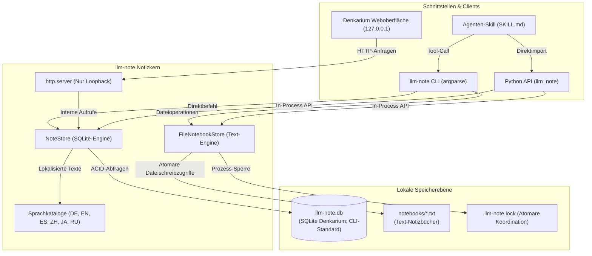
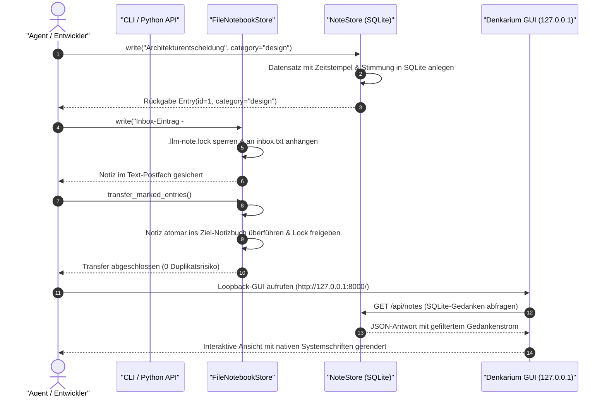

# llm-note

[](https://github.com/doc-bricks/llm-note/actions/workflows/ci.yml)
[](CHANGELOG.md)
[](LICENSE)
[](pyproject.toml)
[](pyproject.toml)
[](CHANGELOG.md)
[](CONTRIBUTING.md)
[-brightgreen.svg)](THIRD_PARTY_LICENSES.md)
[](https://github.com/astral-sh/ruff)
[](https://github.com/doc-bricks)
[](https://github.com/open-bricks)
[](llms.txt)

[Deutsch](README_de.md) · [English](README.md) · [Español](README_es.md) · [简体中文](README_zh-Hans.md) · [日本語](README_ja.md) · [Русский](README_ru.md)

> [!NOTE]
> **Lokal ausgerichtete Notizen:** `llm-note` speichert Notizen lokal in SQLite und Klartextdateien. Für die Kernspeicherung ist kein gehosteter Notizdienst und kein API-Schlüssel erforderlich. Die optionale Weboberfläche bindet an Loopback; die Hostumgebung bestimmt den Netzwerkzugriff.

---

## Schnellnavigation

1. [Überblick & Warum dieses Projekt existiert](#1-ueberblick--warum-dieses-projekt-existiert)
2. [Kernfähigkeiten & Architektur](#2-kernfaehigkeiten--architektur)
3. [Visuelle Systemarchitektur & Datenfluss](#3-visuelle-systemarchitektur)
4. [Sequenzdiagramm: Notiz- & Transfer-Lebenszyklus](#4-sequenzdiagramm-notiz--und-transfer-lebenszyklus)
5. [Zielgruppen & High-Intent Suchbegriffe](#5-zielgruppen--suchbegriffe)
6. [Vergleichsmatrix gegenüber Alternativen](#6-vergleichsmatrix-gegenueber-alternativen)
7. [Governance & Implementierungshinweise](#7-governance--laufzeit-invarianten)
8. [Lokale Denkarium-Weboberfläche](#8-lokale-denkarium-weboberflaeche)
9. [CLI-Befehlsreferenz & Praxisbeispiele](#9-cli-befehlsreferenz--beispiele)
10. [Python API & Programmierbeispiele](#10-python-api--programmierbeispiele)
11. [Agenten-Skill & Workflow-Integration](#11-agenten-skill--workflow-integration)
12. [Text-Notizbücher & Transfer-Semantik](#12-text-notizbuecher--transfer-semantik)
13. [Ökosystem-Matrix & Verwandte Module](#13-oekosystem-matrix--verwandte-module)
14. [Drittanbieter-Abhängigkeiten & Lizenzumfang](#14-drittanbieter-lizenzen--transparenz)
15. [Sicherheitsrichtlinie & Reaktionsziele](#15-sicherheitsrichtlinie--slas)
16. [Verifikation & Test-Suite](#16-verifikation--test-suite)
17. [Rechtlicher Hinweis zu § 521 BGB](#17-gesetzlicher-haftungshinweis--521-bgb)
18. [Roadmap & Änderungsprotokoll](#18-roadmap--aenderungsprotokoll)

---

<a id="sec-01"></a>
<a id="1-overview--why-this-exists"></a>
<a id="overview--why-this-exists"></a>
<a id="1-ueberblick--warum-dieses-projekt-existiert"></a>
<a id="ueberblick--warum-dieses-projekt-existiert"></a>
## 1. Überblick & Warum dieses Projekt existiert

**llm-note** ist ein extrem schlanker, dienstloser lokaler Notizbuch-Kern — in erster Linie ein Notizbuch für Menschen, in das KI-Assistenten und Coding-Agenten für ihre Nutzerin oder ihren Nutzer schreiben, und je nach Einsatz auch ein gemeinsam genutztes Notizbuch.

Autonome Agenten und LLMs müssen während komplexer Arbeitsläufe fortlaufend Entwurfsentscheidungen, Zwischenbeobachtungen und Ideen festhalten, damit ihr Nutzer sie später lesen kann — und, bei gemeinsamer Nutzung, damit Mensch und Agent beide darauf zurückgreifen können. Herkömmliche Lösungen setzen häufig schwere Vektordatenbanken, kostenpflichtige SaaS-Dienste oder ressourcenintensive Electron-Apps voraus, die Telemetriedaten übertragen.

### Modi

`llm-note` erzwingt keinen Modus — es ist dasselbe schlichte Notizbuch, ganz gleich, welche dieser Nutzungsweisen gerade passt:

- **Für Menschen, von LLMs** (Standard): der Mensch liest, sein KI-Assistent schreibt Notizen für ihn.
- **Von Menschen, für LLMs**: der Mensch hinterlässt Notizen, die sein Assistent liest.
- **Gemeinsamer Cowork-Space**: Mensch und KI-Assistenten schreiben in dasselbe Notizbuch — deine LLMs teilen sich deinen Raum.

`llm-note` schließt diese Lücke:
- **Null externe Laufzeitabhängigkeiten**: 100% reine Python-Standardbibliothek (`sqlite3`, `http.server`, `urllib`, `argparse`, `json`, `pathlib`).
- **Duale Speicherarchitektur**: Verbindet strukturierte SQLite-Gedanken (CLI-Standarddatei `llm-note.db`; Pfad konfigurierbar) mit flexiblen, Git-fähigen Klartext-Notizbüchern (`notebooks/*.txt`).
- **BACH-Provenienz**: Sauber von der [BACH-Desktop-Assistenten-Codebasis](https://github.com/ellmos-ai/bach), insbesondere Notizblock und Denkarium, entkoppelt und unter der permissiven MIT-Lizenz freigegeben.

---

<a id="sec-02"></a>
<a id="2-key-capabilities--architecture"></a>
<a id="key-capabilities--architecture"></a>
<a id="2-kernfaehigkeiten--architektur"></a>
<a id="kernfaehigkeiten--architektur"></a>
## 2. Kernfähigkeiten & Architektur

- **SQLite-Denkarium (`NoteStore`)**: Strukturierte Notizen, Logbuch-Einträge, Kategorien, Stimmungswerte und Beförderungs-Marker mit voller ACID-Transaktionssicherheit speichern.
- **Textdatei-Notizbücher (`FileNotebookStore`)**: Portable Text-Notizbücher mit `#NB:`-Kategorisierung und atomarer prozessübergreifender Dateisperre (`.llm-note.lock`).
- **Integrierte Denkarium-Weboberfläche**: Sofort einsatzbereite Loopback-Benutzeroberfläche, strikt an `127.0.0.1` gebunden via `http.server` und mit nativen Systemschriften.
- **Mehrsprachige Lokalisierung**: 6 mitgelieferte Sprachkataloge: Deutsch, Englisch, Spanisch, vereinfachtes Chinesisch, Japanisch und Russisch.
- **Agenten-Skill aus dem Quellrepository**: Das Quellrepository enthält `skills/llm-note/SKILL.md`; laut `pyproject.toml` paketiert das Wheel nur `llm_note`, nicht diesen Quellpfad.
- **Deterministische Suche**: Exakte Teilstring-Suche ohne SQL-Wildcard-Überraschungen mit klar begrenzten Abfragemengen (`0` bis `1000`).

---

<a id="sec-03"></a>
<a id="3-visual-system-architecture"></a>
<a id="visual-system-architecture"></a>
<a id="3-visuelle-systemarchitektur"></a>
<a id="visuelle-systemarchitektur"></a>
## 3. Visuelle Systemarchitektur & Datenfluss



<a id="vier-sichten-architekturtopologie-projektion"></a>
### Vier-Sichten-Architekturtopologie (ASCII-Topologieprojektion)

```text
+==================================================================================================+
|                 LLM-NOTE -- VIER-SICHTEN-ARCHITEKTURTOPOLOGIE (LOKALER NOTIZKERN)                |
+==================================================================================================+
| [SICHT 1: CLIENT-SCHNITTSTELLEN, WEBOBERFLAECHE & AGENTEN-INTEGRATION]                           |
|  * Universelle CLI [INV-LOCAL-04]: argparse-basierter Befehl fuer write, read, search & stats    |
|  * Denkarium-Weboberflaeche [INV-LOCAL-06]: Zero-Install Loopback-Interface strikt auf 127.0.0.1|
|  * Python-API-Integration: Direkte In-Process-Nutzung von NoteStore und FileNotebookStore       |
|  * Agenten-Skill [INV-LOCAL-09]: Quellrepository-SKILL.md fuer autonome Assistenten             |
+--------------------------------------------------------------------------------------------------+
                                                |
                                                | Strukturierte API-Aufrufe & Text-Inbox-Operationen
                                                v
+--------------------------------------------------------------------------------------------------+
| [SICHT 2: DUALE NOTIZ-ENGINES, SQLITE-GEDANKENSPEICHER & INBOX-TRANSFERS]                        |
|  * Strukturierter Gedankenspeicher [INV-LOCAL-02]: SQLite NoteStore mit ACID-Transaktionen       |
|  * Text-Notizbuchverwaltung [INV-LOCAL-03]: Menschenlesbare notebooks/*.txt mit #NB:-Routing     |
|  * Atomare Transfer-Engine [INV-LOCAL-05]: Idempotente #LLM-NOTE-ID-Marker & .llm-note.lock     |
|  * Deterministische Suche: Substring-Treffer ohne Wildcard-Ueberraschungen (Limits 0..1000)      |
+--------------------------------------------------------------------------------------------------+
                                                |
                                                | Speicherpersistenz & Lokalisierungskataloge
                                                v
+--------------------------------------------------------------------------------------------------+
| [SICHT 3: LAUFZEIT-PERSISTENZ, KOORDINATION & MEHRSPRACHIGKEIT]                                  |
|  * SQLite-Einzeldatei-Persistenz: Konfigurierbarer DB-Pfad mit automatischer Schemainitialisierung|
|  * Prozessuebergreifende Sicherheit: Beratende Dateisperre verhindert Transfer-Kollisionen       |
|  * Mehrsprachige Lokalisierung [INV-LOCAL-07]: 6 mitgelieferte Kataloge (DE, EN, ES, ZH, JA, RU)|
|  * Browser-unabhaengige I18N: Client-Praeferenzspeicherung mit CLI-Fallback-Prioritaet           |
+--------------------------------------------------------------------------------------------------+
                                                |
                                                | Begrenzte Ausfuehrung, Aufrufer-Rechte & Governance
                                                v
+--------------------------------------------------------------------------------------------------+
| [SICHT 4: BEGRENZTE AUSFUEHRUNG, AUFRUFER-RECHTE & GOVERNANCE-RAHMEN]                            |
|  * Lokale Speicherung [INV-LOCAL-01]: Notizen lokal in SQLite und Textdateien abgelegt           |
|  * Keine externen Laufzeit-Abhaengigkeiten [INV-LOCAL-04]: 100% reine Python-Standardbibliothek |
|  * Aufrufer-Rechte [INV-LOCAL-08]: Keine Rechteausweitung; erbt Berechtigungen des Elternprozesses|
|  * Sicherheits- & Reaktionsziele [INV-LOCAL-10]: 48h-Bestaetigungsziel gemaess SECURITY.md       |
|  * Offene Governance & Recht [INV-LOCAL-01..10]: MIT-Lizenz, Level-1-SBOM-Notizen & § 521 BGB   |
+--------------------------------------------------------------------------------------------------+
```

---

<a id="sec-04"></a>
<a id="4-note--transfer-lifecycle-sequence"></a>
<a id="note--transfer-lifecycle-sequence"></a>
<a id="4-sequenzdiagramm-notiz--und-transfer-lebenszyklus"></a>
<a id="sequenzdiagramm-notiz--und-transfer-lebenszyklus"></a>
## 4. Sequenzdiagramm: Notiz- & Transfer-Lebenszyklus



---

<a id="sec-05"></a>
<a id="5-target-personas--discoverability"></a>
<a id="target-personas--discoverability"></a>
<a id="5-zielgruppen--suchbegriffe"></a>
<a id="zielgruppen--suchbegriffe"></a>
## 5. Zielgruppen & High-Intent Suchbegriffe

`llm-note` wurde für vier zentrale Anwendungsszenarien optimiert:

| Persona ID | Zielgruppe | Kernbedarf | Bereitgestellter Nutzen |
| :--- | :--- | :--- | :--- |
| `[PERSONA-01]` | **Autonome Agenten-Entwickler** | Gedankenspeicher über Kontext-Resets hinweg | Null-Abhängigkeiten SQLite-Speicher zur sofortigen Einbettung |
| `[PERSONA-02]` | **Datenschutzbewusste Entwickler** | Lokale SQLite-Notizen und Klartext-Postfächer ohne gehosteten Notizdienst | Lokal ausgerichtete Speicherung; der Host steuert den Netzwerkzugriff |
| `[PERSONA-03]` | **Desktop-KI-Assistenten-Nutzer** | Schnelle visuelle Gedankenübersicht ohne Node/Electron | Integrierte Loopback Denkarium-Oberfläche (`127.0.0.1`) |
| `[PERSONA-04]` | **Open-Science-Forscher** | In Git versionierbare, auditierbare Notizen & Logbücher | Text-Dateien und standardkonforme SQLite-Einzeldateien |

### Relevante Suchbegriffe

- **Deutsch**: `lokaler KI Agenten Notizspeicher`, `autonomes Agenten Gedächtnis ohne Cloud`, `datenschutzkonformer Notizblock offline`, `Agenten Denkarium Browser UI`, `einfaches LLM Logbuch Python`.
- **Englisch**: `local-first LLM notes`, `SQLite note store for agents`, `agent notebook CLI`, `private AI notebook`, `zero-dependency agent memory python`, `Denkarium agent thought browser`.

---

<a id="sec-06"></a>
<a id="6-comparative-matrix-vs-alternatives"></a>
<a id="comparative-matrix-vs-alternatives"></a>
<a id="6-vergleichsmatrix-gegenueber-alternativen"></a>
<a id="vergleichsmatrix-gegenueber-alternativen"></a>
## 6. Vergleichsmatrix gegenüber Alternativen

| Architektur-Dimension | `llm-note` | Obsidian | Joplin | Vektordatenbanken | Reine SQLite CLI |
| :--- | :---: | :---: | :---: | :---: | :---: |
| **1. Speicher-Engine** | **SQLite + TXT** | Markdown-Dateien | SQLite / Sync | Vektor-Embeddings | Einzelne SQLite-Datei |
| **2. Laufzeitabhängigkeiten** | **0 (Nur Stdlib)** | Electron / Node | Electron / DB | Schweres C++ / Py | 0 (C-Binary) |
| **3. Netzwerkanforderungen** | **Lokale Speicherung; Hostrichtlinie gilt** | Nicht geprüft | Nicht geprüft | Nicht geprüft | Nicht geprüft |
| **4. Agenten Python-API** | **Erstklassig Nativ** | Community REST | Community-API | Komplexe Clients | Reines SQL nötig |
| **5. Lokale Web-GUI** | **Integriert (127.0.0.1)**| Desktop-App | Desktop-App | Separates SaaS | Keine |
| **6. Text-Postfach Sync** | **Integriert (`#NB:`)** | Manuelle Ordner | Manueller Import | Nicht vorhanden | Manuelle Skripte |
| **7. Lokalisierung** | **6 Sprachdateien** | Community-Pack | Community-Pack | Meist nur Englisch | Nur Englisch |
| **8. Prozessrechte** | **Übernimmt Rechte des Aufrufers** | Nicht geprüft | Nicht geprüft | Nicht geprüft | Nicht geprüft |
| **9. Agenten-Skill-Quelle** | **Quellrepository; nicht im Wheel** | Drittanbieter | Drittanbieter | Eigener Code | Keine |
| **10. Informationen zur Sicherheitsreaktion** | **Maintainer-Ziele in SECURITY.md** | Nicht geprüft | Nicht geprüft | Nicht geprüft | Nicht geprüft |

---

<a id="sec-07"></a>
<a id="7-governance--runtime-invariants"></a>
<a id="governance--runtime-invariants"></a>
<a id="7-governance--laufzeit-invarianten"></a>
<a id="governance--laufzeit-invarianten"></a>
## 7. Governance & Implementierungshinweise

Die folgenden Punkte beschreiben den aktuellen, im Quellcode belegten Stand. Sie sind keine unveränderlichen Garantien oder externe Sicherheitszertifizierung:

- `INV-LOCAL-01`: **Lokal ausgerichtete Speicherung** — Notizen liegen in lokalem SQLite und Klartextdateien; der Host-Netzwerkzugriff wird dadurch nicht blockiert.
- `INV-LOCAL-02`: **SQLite-Einzeldatei-Speicher** — Strukturierte ACID-Datenbank; die CLI-Standarddatei heißt `llm-note.db`, der Pfad ist konfigurierbar.
- `INV-LOCAL-03`: **Klartext-Notizbuch-Postfächer** — Für Menschen lesbare Textdateien (`notebooks/*.txt`) mit `#NB:`-Kategorisierung.
- `INV-LOCAL-04`: **Ausschließlich Standardbibliothek** — Null externe Laufzeitabhängigkeiten; lauffähig auf jedem Standard-Python 3.10+.
- `INV-LOCAL-05`: **Absturzsichere atomare Transfers** — Dateisperren via `.llm-note.lock` und `#LLM-NOTE-ID`-Idempotenz-Marker.
- `INV-LOCAL-06`: **Strikte Loopback-Web-GUI** — Denkarium lauscht ausschließlich auf `127.0.0.1`; `--no-browser` Modus verfügbar.
- `INV-LOCAL-07`: **Mehrsprachigkeit (I18N)** — 6 vollständige Lokalisierungskataloge: DE, EN, ES, ZH, JA, RU.
- `INV-LOCAL-08`: **Prozessrechte** — Die Anwendung fordert keine Erhöhung an und übernimmt die Berechtigungen des aufrufenden Prozesses.
- `INV-LOCAL-09`: **Agenten-Skill-Quelle** — Das Quellrepository enthält [`skills/llm-note/SKILL.md`](skills/llm-note/SKILL.md); `pyproject.toml` paketiert nur `llm_note`, daher wird dieser Quellpfad nicht als Wheel-Inhalt ausgewiesen.
- `INV-LOCAL-10`: **Reaktionsziele des Maintainers** — `SECURITY.md` nennt Eingangs- und Triageziele; sie sind kein SLA und keine Frist für eine Korrektur.

---

<a id="sec-08"></a>
<a id="8-denkarium-local-web-gui-guide"></a>
<a id="denkarium-local-web-gui-guide"></a>
<a id="8-lokale-denkarium-weboberflaeche"></a>
<a id="lokale-denkarium-weboberflaeche"></a>
## 8. Lokale Denkarium-Weboberfläche

Die Denkarium-Oberfläche bietet eine sofortige, installationsfreie visuelle Notizverwaltung. Wähle im Menü „Sprache“ zwischen den sechs Sprachen. Die Auswahl gilt pro Browser und wird im lokalen Speicher dieses Browsers gesichert. Wird das GUI mit einem expliziten `--locale` gestartet, hat dieser Wert für die Anfangssprache Vorrang; andernfalls gilt die gespeicherte Browserauswahl, mit Englisch als Standard.

```bash
# Denkarium mit Standardwerten starten (öffnet http://127.0.0.1:8000/)
llm-note --locale de gui

# Eigene Datenbank, Port und deutsche Sprache vorgeben
llm-note --db data/notes.db --locale de gui --port 8765

# Headless-Modus für Hintergrundprozesse oder Tests
llm-note gui --port 8765 --no-browser
```

### Technische Highlights der Weboberfläche
- **Kein Framework-Ballast**: Reines HTML/CSS/JavaScript, direkt über Pythons `http.server` ausgeliefert.
- **Responsives Design**: Optimiert für Desktop und mobile Endgeräte mit Systemschriften (`Segoe UI`, `SF Pro`, `system-ui`).
- **REST-JSON-Schnittstellen**:
  - `GET /api/notes?search=<begriff>&category=<kat>&limit=<n>`
  - `POST /api/notes` (erstellt neuen Gedanken-Eintrag)

---

<a id="sec-09"></a>
<a id="9-cli-complete-reference--examples"></a>
<a id="cli-complete-reference--examples"></a>
<a id="9-cli-befehlsreferenz--beispiele"></a>
<a id="cli-befehlsreferenz--beispiele"></a>
## 9. CLI-Befehlsreferenz & Praxisbeispiele

### Installation

`llm-note` ist noch nicht auf PyPI veröffentlicht. Die Installation erfolgt aus dem Repository (Python 3.10+, keine Laufzeitabhängigkeiten von Drittanbietern):

```bash
pip install git+https://github.com/doc-bricks/llm-note.git
# oder aus einem lokalen Klon
git clone https://github.com/doc-bricks/llm-note.git && cd llm-note && pip install .
```

Damit stehen der Befehl `llm-note` und das Python-Paket `llm_note` bereit.


```bash
# Notiz mit Kategorie und Stimmung erfassen
llm-note --locale de write "Caching-Schicht optimieren" --cat dev --mood 4

# Jüngste Notizen lesen (Standardlimit: 10)
llm-note --locale de read --limit 5

# Notizen wörtlich suchen (keine Wildcard-Ersetzung)
llm-note --locale de search "Caching"

# Brainstorming-Eintrag für spätere Weiterverarbeitung anlegen
llm-note --locale de brainstorm "Zero-Copy Serialisierungsoptionen"

# Zusammenfassende Statistik abrufen
llm-note --locale de stats

# Mit benutzerdefiniertem Datenbankpfad arbeiten
llm-note --db custom/notes.db --locale de read --limit 3
```

---

<a id="sec-10"></a>
<a id="10-python-api-guide--code-examples"></a>
<a id="python-api-guide--code-examples"></a>
<a id="10-python-api--programmierbeispiele"></a>
<a id="python-api--programmierbeispiele"></a>
## 10. Python API & Programmierbeispiele

```python
from llm_note import NoteStore, FileNotebookStore

# 1. SQLite NoteStore initialisieren
notes = NoteStore("data/notes.db")

# 2. Strukturierten Gedanken anlegen
entry = notes.write(
    content="Deterministischen Seed für Test-Suite einrichten",
    category="testing",
    mood=4
)
print(f"Eintrag #{entry.id} erstellt am {entry.created_at}")

# 3. Notizen durchsuchen
matches = notes.search("deterministisch")
for match in matches:
    print(f"Treffer: {match.content} [{match.category}]")

# 4. Notiz zur Aufgabe befördern
notes.promote(entry.id, target="task")

# 5. Text-Notizbücher koordinieren
notebooks = FileNotebookStore("notebooks")
notebooks.write("Release-Mitteilung vorbereiten\n#NB: Marketing")
transferred = notebooks.transfer_marked_entries()
print(f"{transferred} Einträge in Themen-Notizbücher übertragen.")
```

---

<a id="sec-11"></a>
<a id="11-agent-skill--workflow-integration"></a>
<a id="agent-skill--workflow-integration"></a>
<a id="11-agenten-skill--workflow-integration"></a>
<a id="agenten-skill--workflow-integration"></a>
## 11. Agenten-Skill & Workflow-Integration

Das Quellrepository enthält die Agenten-Skill-Definition [`skills/llm-note/SKILL.md`](skills/llm-note/SKILL.md). Das Wheel paketiert laut [`pyproject.toml`](pyproject.toml) nur `llm_note`; der Skill-Quellpfad wird daher nicht als Wheel-Inhalt behauptet. Autonome Agenten können `llm-note` nutzen, um Beobachtungen festzuhalten und Notizblöcke zu pflegen.

```markdown
# Beispiel für einen Agenten-Werkzeugaufruf
Zur Sicherung einer Zwischenbeobachtung:
`llm-note write "3 Randfälle beim Token-Parsing identifiziert" --cat research`
```

---

<a id="sec-12"></a>
<a id="12-file-based-inboxes--transfer-semantics"></a>
<a id="file-based-inboxes--transfer-semantics"></a>
<a id="12-text-notizbuecher--transfer-semantik"></a>
<a id="text-notizbuecher--transfer-semantik"></a>
## 12. Text-Notizbücher & Transfer-Semantik

- **Standard-Postfach**: Einträge ohne Markierung landen in `notebooks/inbox.txt`.
- **Ziel-Routing**: Das Anhängen von `#NB: <Themenname>` leitet den Eintrag nach `notebooks/<Themenname>.txt`.
- **Atomare Überführung**: Der Aufruf von `transfer_marked_entries()` extrahiert alle markierten Notizen, vergibt eine stabile Kennung `#LLM-NOTE-ID: <hash>`, fügt sie an die Zieldatei an und schreibt die Quelldatei atomar neu.
- **Mehrprozess-Sicherheit**: Zugriffskonflikte werden über die Kontrolldatei `.llm-note.lock` im Notizbuch-Verzeichnis verhindert.

---

<a id="sec-13"></a>
<a id="13-sibling-ecosystem-matrix"></a>
<a id="sibling-ecosystem-matrix"></a>
<a id="13-oekosystem-matrix--verwandte-module"></a>
<a id="oekosystem-matrix--verwandte-module"></a>
## 13. Ökosystem-Matrix & Verwandte Module

Die folgenden Einträge verweisen auf verwandte Projekte. Die FolderHome-Zeile beschreibt zusätzlich eine Anbieterbeziehung, die auf den zitierten Quellstand und Pin begrenzt ist; sie behauptet keine Kompatibilität mit aktuellem `main` und keine Freischaltung des Live-Betriebs.

| Projekt | Fokus & Rolle im Ökosystem | Verweis |
| :--- | :--- | :--- |
| **ellmos-ai/FolderHome** | Das Komponentenmanifest pinnt dieses Repository auf `b5fe59fc155ded9603566aa0fb920a53181a2426` und deklariert `notes.read` sowie freigabepflichtiges `notes.write` (`default_mode = dry-run`, `live_enabled = false`). | [Manifest am Quellstand 51d5dc7](https://github.com/ellmos-ai/FolderHome/blob/51d5dc71ec11f1cde4598c528323483a50f6e52c/manifests/components/llm-note.toml), [Provider-Guide](https://github.com/ellmos-ai/FolderHome/blob/51d5dc71ec11f1cde4598c528323483a50f6e52c/docs/provider-checkouts.md) |
| **doc-bricks/llm-note** | Lokaler Notiz- und Denkarium-Kern für Agenten | [doc-bricks/llm-note](https://github.com/doc-bricks/llm-note) |
| **doc-bricks/MediaBrain** | Persönliche Video- und Musikbibliothek mit Smart-Playlists und Streaming-Verlauf | [doc-bricks/MediaBrain](https://github.com/doc-bricks/MediaBrain) |
| **doc-bricks/MailProcessor** | Windows-Infobereichs-App zum Starten der lokalen Universal-Mail-Werkzeuge | [doc-bricks/MailProcessor](https://github.com/doc-bricks/MailProcessor) |
| **file-bricks/ProSync** | Plattformübergreifende Verzeichnis-Synchronisation | [file-bricks/ProSync](https://github.com/file-bricks/ProSync) |
| **file-bricks/CloudLockFixer** | Verzögert Dateiaktionen in Cloud-Sync-Ordnern und prüft Kopier-/Lösch-Fallbacks mit SHA-256 | [file-bricks/CloudLockFixer](https://github.com/file-bricks/CloudLockFixer) |
| **open-bricks-Organisationsprofil** | Organisationsprofil und Dachkatalog; kein einzelnes Repository | [open-bricks auf GitHub](https://github.com/open-bricks) |

---

<a id="sec-14"></a>
<a id="14-third-party-licenses--transparency"></a>
<a id="third-party-licenses--transparency"></a>
<a id="14-drittanbieter-lizenzen--transparenz"></a>
<a id="drittanbieter-lizenzen--transparenz"></a>
## 14. Drittanbieter-Abhängigkeiten & Lizenzumfang

`pyproject.toml` deklariert keine zusätzlichen Python-Laufzeitpakete. Der Kern verwendet die Python-Standardbibliothek und SQLite aus der Python-Umgebung.

- Begrenzte Hinweise zu direkt deklarierten Abhängigkeiten: [`THIRD_PARTY_LICENSES.md`](THIRD_PARTY_LICENSES.md) und [`THIRD_PARTY_LICENSES.txt`](THIRD_PARTY_LICENSES.txt). Sie sind keine vollständigen SBOMs.
- Die Abhängigkeitsnotizen zertifizieren nicht den Lizenzstatus vollständiger transitiver Build- oder Entwicklungsabhängigkeiten.
- Der Prozess fordert keine Administratorerhöhung an und übernimmt die Berechtigungen des aufrufenden Prozesses; das ist keine Plattformzertifizierung.

---

<a id="sec-15"></a>
<a id="15-security-policy--slas"></a>
<a id="security-policy--slas"></a>
<a id="15-sicherheitsrichtlinie--slas"></a>
<a id="sicherheitsrichtlinie--slas"></a>
## 15. Sicherheitsrichtlinie & Reaktionsziele

Meldeweg und Reaktionsziele des Maintainers stehen in [`SECURITY.md`](SECURITY.md):

- **Implementierungsgrenze:** Der Notizkern nutzt lokale Speicherung, und die optionale Weboberfläche bindet an Loopback. Die Anwendung blockiert weder den Host-Netzwerkzugriff noch stellt sie eine Sandbox bereit.
- **Reaktionsziele des Maintainers:** Eingangsbestätigung innerhalb von 48 Stunden und Beginn der Triage innerhalb von 5 Werktagen sind Ziele, kein SLA und keine zugesagte Korrekturfrist.
- **Kontakt**: Vertrauliche Sicherheitsmeldungen bitte über den in [SECURITY.md](SECURITY.md) beschriebenen privaten Meldeweg einreichen.

---

<a id="sec-16"></a>
<a id="16-verification--contract-test-suite"></a>
<a id="verification--contract-test-suite"></a>
<a id="16-verifikation--test-suite"></a>
<a id="verifikation--test-suite"></a>
## 16. Verifikation & Test-Suite

Die Testsuite lässt sich lokal wie folgt ausführen:

```bash
# Modultests und Vertragstests starten
python -m pytest -ra -v

# Schnellen Ruff-Linter ausführen
ruff check .

# Bytecode-Kompilierung prüfen
python -m compileall -q .
```

---

<a id="sec-17"></a>
<a id="17-german-statutory-notice--521-bgb"></a>
<a id="german-statutory-notice--521-bgb"></a>
<a id="17-gesetzlicher-haftungshinweis--521-bgb"></a>
<a id="gesetzlicher-haftungshinweis--521-bgb"></a>
## 17. Rechtlicher Hinweis zu § 521 BGB

Dieser Hinweis trifft keine Aussage dazu, ob § 521 BGB auf eine konkrete Bereitstellung anwendbar ist oder welche Haftungsfolgen eintreten. Das hängt von den Umständen des Einzelfalls ab.

§ 521 BGB kann abhängig von den konkreten Umständen relevant sein. Dieser Hinweis bestimmt weder die Anwendbarkeit auf eine bestimmte Bereitstellung noch deren Haftungsfolgen.

---

<a id="sec-18"></a>
<a id="18-roadmap--changelog"></a>
<a id="roadmap--changelog"></a>
<a id="18-roadmap--aenderungsprotokoll"></a>
<a id="roadmap--aenderungsprotokoll"></a>
## 18. Roadmap & Änderungsprotokoll

- **Änderungsprotokoll**: Detaillierte Versionshistorie in [`CHANGELOG.md`](CHANGELOG.md).
- **Roadmap & Aufgaben**: Aktuelle Meilensteine und offene Punkte in [`TODO.md`](TODO.md).
- **KI-Kontextindex**: Vollständige Dokumentationsübersicht in [`llms.txt`](llms.txt).

---

## Lizenz

[MIT](LICENSE) - Copyright (c) 2026 Lukas Geiger.
